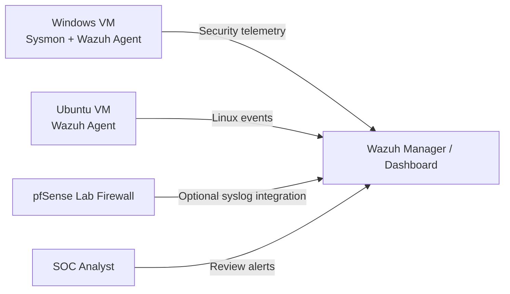

# SOC Home Lab — Documentation and Build Plan

**Status:** Proposed reference architecture and checklist; **not a claim that all components are currently installed or connected**.

## Objective

Practice centralized monitoring, endpoint telemetry analysis, and basic SOC alert triage using an isolated environment.

## Reference architecture

Components: virtualization host, isolated Windows test VM, Ubuntu Server, Wazuh manager/dashboard, Sysmon and Wazuh agents, optional pfSense firewall/syslog. Configure appropriate system resources and secure access based on official vendor documentation.

## Safe implementation checklist

- [ ] Document the host hardware and VM network isolation.
- [ ] Install Wazuh manager/dashboard using current official instructions.
- [ ] Install and register a Windows test agent.
- [ ] Install Sysmon on a Windows test VM with a reviewed configuration.
- [ ] Verify Windows event collection and timestamps.
- [ ] Register an Ubuntu test agent and verify log collection.
- [ ] Optionally integrate pfSense logs through a **supported, tested** pipeline.
- [ ] Generate harmless test events on authorized lab hosts only.
- [ ] Capture sanitized evidence of event and alert flow.
- [ ] Write one completed investigation with what was **actually** observed.

## Validation record template

| Field | Entry |
| --- | --- |
| Test date | TBD |
| Operating systems / versions | TBD |
| Event generated | TBD |
| Relevant event IDs / fields | TBD |
| Data reached Wazuh? | Not yet recorded |
| Alert generated? | Not yet recorded |
| Analyst findings | TBD |
| Evidence (sanitized) | TBD |

## First exercise suggestion

Produce a few failed sign-in attempts using a dedicated **test account on your own VM**. Inspect the Windows Security log and check whether the events were ingested in Wazuh. Do not equate failed logins with a confirmed attack: examine account, source host, frequency, timeframe and surrounding activity.

## Disclosure

No live topology, credentials, internal IP addresses, customer identifiers, or screenshots are included. Add evidence only after verifying it is safe to share.
