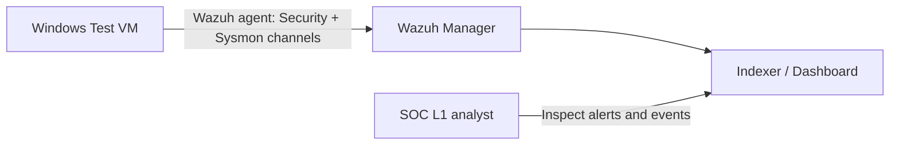

# Wazuh Detection Lab — Windows Security & Sysmon

**Status: Lab guide ready; execution and results NOT YET VERIFIED.**

This project shows how I plan to validate Windows event ingestion and perform entry-level SOC alert triage using Wazuh.

## Architecture

## Learning objectives
- Ingest Windows Security and Sysmon Operational logs.
- Identify Windows logon failures (4625) and successful logons (4624).
- Inspect process creation (Sysmon Event ID 1), with attention to process ancestry and command line.
- Write evidence-based triage notes and consider benign explanations.
- Correlate relevant observations with MITRE ATT&CK only when justified.

## Prerequisites
- A Windows VM you own or are explicitly authorized to test.
- A functioning Wazuh manager/indexer/dashboard and a connected Windows Wazuh agent.
- Sysmon installed on the Windows test VM with a carefully reviewed configuration.
- Auditing enabled for appropriate logon events.
- Synchronized clocks and network isolation appropriate to your lab.

Follow the [official Wazuh documentation](https://documentation.wazuh.com/current/) for your installed version and [Microsoft Sysmon documentation](https://learn.microsoft.com/en-us/sysinternals/downloads/sysmon).

## Configure event channels
See [agent-config-example.xml](agent-config-example.xml) for a *fragment*, not a complete agent configuration file. Merge applicable `<localfile>` entries **inside the existing `<ossec_config>` element** in the Windows agent `ossec.conf`. Do not overwrite a working config. Check version support and restart the agent only after validating changes.

## Exercise 1 — Windows sign-in triage

1. Verify the Wazuh agent is reporting in the dashboard.
2. On your isolated Windows VM, use a dedicated non-privileged test account.
3. Perform a small number of manual unsuccessful logons; remain below the account lockout policy.
4. If safe and appropriate, complete one successful sign-in.
5. Inspect native Windows Security logs for event IDs **4625** and **4624**. Actual event generation depends on account type, audit policy and sign-in mechanism.
6. Check Wazuh records; filter by agent and a suitable time range. Inspect the **actual indexed field names** before constructing filters.
7. Record what appeared, what did not, and plausible benign explanations.
8. Add **redacted** evidence and a completed [validation log](validation-log.md).

Example field names sometimes used in Wazuh Windows event documents: `agent.name`, `data.win.system.eventID`, `data.win.eventdata.targetUserName`. **Mappings differ**, so never assume these are available in every version.

For a **fictional worked scenario** (not a live result), see [CASE-001](../soc-case-studies/CASE-001-windows-failed-logons/README.md).

## Exercise 2 — Sysmon process telemetry

1. Confirm the Sysmon Operational event channel is generating logs on your VM.
2. Open a benign app (e.g., Notepad) under the test account.
3. Locate Sysmon **Event ID 1** locally and then in Wazuh if ingested.
4. Check `Image`, `ParentImage`, `User` and `CommandLine` where collected.
5. Explain whether the activity is expected, and why seeing a process event is not inherently a malicious alert.

## Evidence standards

No fabricated dashboard screenshots, rule IDs or detection results. Save dated, sanitized screenshots only after real tests. Do not publish secrets, raw customer logs, internal infrastructure details or company-specific detections.

## Status checklist
- [x] Documentation and planned exercises
- [x] Example channel collection fragment
- [x] Validation-report template
- [ ] Windows/agent telemetry verified in an authorized test environment
- [ ] Actual Wazuh output documented with sanitized evidence
- [ ] Analyst report linked to observed results

**Reference:** [Wazuh docs](https://documentation.wazuh.com/current/) · [Sysmon docs](https://learn.microsoft.com/en-us/sysinternals/downloads/sysmon) · [MITRE ATT&CK](https://attack.mitre.org/)
